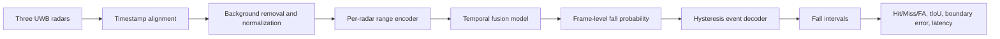

# UWB Fall Localization

Research-grade continuous fall detection and temporal localization from
privacy-preserving multi-radar UWB streams.

## Research question

Can a compact, calibrated temporal model detect falls in an unsegmented stream
while controlling false alarms and accurately localizing event boundaries?

## Data governance

The ABC 2027 UWB challenge package is approximately 8.2 GB and is distributed
under CC BY-NC 4.0. Raw data, annotations and derived subject-level data are
never committed. This repository stores only code, configurations, aggregate
metrics and provenance records.

Official source:
<https://sites.google.com/view/abc2027-uwbfalltrack-challenge/dataset-and-tutorial>

## Evaluation-first roadmap

1. Reproduce the two official baselines without changing their split.
2. Freeze an event-level evaluator before model development.
3. Establish signal, CNN-LSTM and TCN baselines.
4. Fit temporal decoding only on validation streams.
5. Report event recall, false alarms/hour, tIoU, start/end error and latency.
6. Add calibration, uncertainty and cross-subject robustness experiments.

The initial implementation contains deterministic interval decoding and
event-level matching utilities with unit tests. Model code is added only after
the official package schema is audited.

