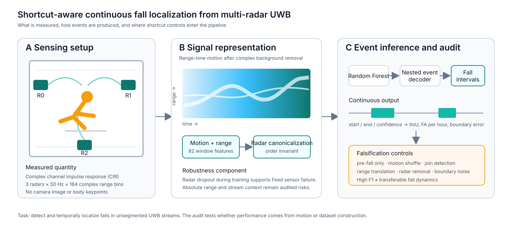
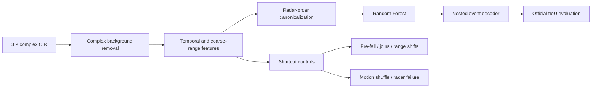

# Shortcut-aware UWB fall localization

Continuous fall detection and temporal localization from three UWB radars. The project began as an ABC 2027 baseline reproduction and developed into an audit of what models learn from synthetic continuous streams.

## Main finding

Tree models outperform the published energy baseline, but most of the gain survives temporal motion destruction. Pre-fall context, absolute range, and synthetic join boundaries are highly predictable. Matched controls show that falls are not unusually close to joins, so join detectability is not evidence that the fall detector uses it. A high event F1 here does not by itself establish transferable fall recognition.

| Result | Value |
|---|---:|
| Official energy baseline ranking F1 | 0.3151 |
| Five-seed invariant RF mean | 0.6561 |
| Pre-fall-only ROC-AUC | 0.9407 |
| Join-boundary ROC-AUC | 0.9811 |
| Motion-shuffled ranking F1 | 0.6308 |
| TinyTCN clean / shuffled ranking F1 | 0.5731 / 0.5039 |
| TinyTCN pre-fall ROC-AUC | 0.6779 |

Five-seed RF results range from 0.6229 to 0.6763. Evaluation uses five subject-disjoint validation streams and 67 evaluable events, so conclusions are limited to this release and its stream construction.



## Pipeline



Radar-group sorting makes the representation exactly invariant to sensor order. Radar-dropout training reaches ranking F1 of 0.6450, 0.4485, and 0.3467 when radar 0, 1, or 2 is missing. A fair mean-imputation baseline reaches 0.0905, 0.4354, and 0.1456, so the robustness gain is clear for two sensors and marginal for one.

A 37k-parameter TCN supplies a genuinely order-sensitive control. Shuffling time reduces its score by 12.1%, compared with 4.1% for the summary-feature RF, and lowers pre-fall predictability from 0.9407 to 0.6779. It uses temporal evidence more strongly but has lower clean localization performance, exposing a robustness–accuracy trade-off rather than a new state of the art.

## Reproduce

```bash
python -m venv .venv
source .venv/bin/activate
pip install -r requirements-research.txt
pip install -e .
make test
```

Place the extracted official v1 package at `data/extracted/abc2027_uwb_train_v1`, then run `make cache` and `make baselines`. `make figures` rebuilds figures from committed results without reading raw HDF5 streams. Full commands are in [docs/reproduction.md](docs/reproduction.md).

## Evidence map

- [Protocol audit](docs/protocol_audit.md)
- [Frozen shortcut protocol](docs/preregistration_shortcut_audit_v1.md)
- [Baseline reproduction](reports/baseline_reproduction.md)
- [Shortcut controls](reports/shortcut_audit/README.md)
- [Spatial controls](reports/spatial_audit/README.md)
- [Boundary analysis](reports/boundary_analysis/README.md)
- [Failure analysis](reports/failure_analysis/README.md)
- [Missing-radar evaluation](reports/dropout_failure_audit/README.md)
- [Fair missing-radar baselines](reports/imputation_audit/README.md)
- [Temporal TCN controls](reports/temporal_tcn/README.md)
- [Seed stability](reports/multiseed/README.md)

## Scope

The official package is CC BY-NC 4.0. Raw streams, caches, and checkpoints are excluded from Git; hashes are in `docs/data_manifest.md`. Hidden test data are not used for fitting or selection. This repository does not claim clinical validation or real-world state of the art.
