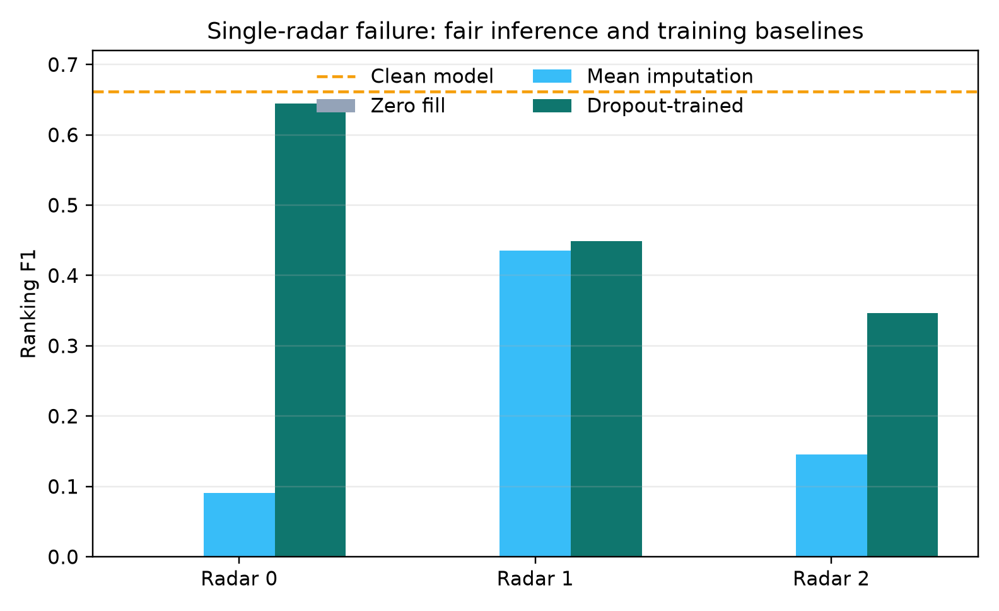

# Fair missing-radar baselines

Zeroing a failed radar is an out-of-distribution input for a model trained only
on complete observations. Its zero score is therefore not a sufficient baseline
for claiming fault tolerance. We add a no-retraining baseline that replaces the
missing radar's range-time power map with the pointwise mean of the two available
radars before extracting the same features.

| Failed sensor | Zero fill | Mean imputation | Radar-dropout training |
|---|---:|---:|---:|
| Radar 0 | 0.0000 | 0.0905 | **0.6450** |
| Radar 1 | 0.0000 | 0.4354 | **0.4485** |
| Radar 2 | 0.0000 | 0.1456 | **0.3467** |

Mean imputation shows that the earlier all-zero result partly reflected an
unfair failure representation. Dropout training still gives a large advantage
for radar 0 and radar 2, while its 0.013 advantage for radar 1 is too small to
interpret without paired uncertainty. The defensible claim is therefore that
dropout training improves robustness over a reasonable fixed imputation for two
of three sensor failures, not that it universally recovers a model from zero.

