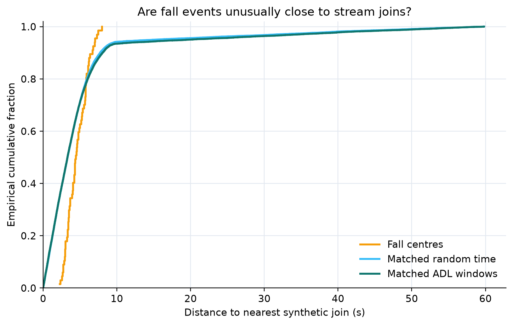

# Shortcut audit

This report covers the first two controls frozen in
`docs/preregistration_shortcut_audit_v1.md`. Both controls failed the intended
invariance test. The current Random Forest result should therefore be read as a
dataset-specific detection result, not evidence that the model has isolated
fall dynamics.

## Pre-fall control

Each positive input is a two-second window ending 0.5 seconds before an event
starts. Negatives are sampled from the same stream and kept at least five
seconds away from every event. The model is fit on official training streams
and evaluated on the 67 evaluable validation events.

| Measure | Result |
|---|---:|
| Validation ROC-AUC | 0.9407 |
| Stream-bootstrap 95% interval | [0.9067, 0.9823] |
| Training positives / negatives | 359 / 359 |
| Validation positives / negatives | 67 / 67 |

The lower confidence limit is well above 0.5 and the point estimate exceeds the
preregistered 0.70 threshold. H2 is rejected. Pre-event context alone carries a
strong label signal. This test does not identify whether the signal comes from
room state, source-segment construction, position, or motion immediately before
the annotated onset.

## Motion-shuffle control

For every two-second validation window, time samples are independently
permuted within each radar and range bin. I/Q pairs use the same permutation.
This keeps each radar/range marginal power distribution while destroying
cross-bin temporal coherence. The clean model and decoder are applied without
refitting on shuffled inputs.

| Measure | Clean nested RF | Motion shuffled |
|---|---:|---:|
| Ranking F1 | 0.6575 | 0.6308 |
| F1 @ tIoU 0.3 | 0.7034 | 0.7077 |
| F1 @ tIoU 0.7 | 0.1931 | 0.1846 |
| False alarms/hour @ 0.3 | 13.18 | 8.30 |

Relative to the official energy baseline (0.3151), the shuffled control retains
about 92% of the clean model's ranking-F1 improvement. This exceeds the
preregistered 80% rejection threshold, so H1 is rejected.

## Consequence

The earlier score improvement is real under the official metric, but its
interpretation changes. Coarse range and energy marginals explain most of the
gain; coherent event motion explains much less than expected. The next method
must be evaluated by how much it reduces pre-fall predictability and sensitivity
to range position, not only by whether it raises validation F1.

Next checks are paired stream-level differences, range translation/masking,
radar removal, and source-boundary analysis. A larger temporal network remains
deferred until those controls are complete.

## Paired stream comparisons

Comparisons resample complete streams in pairs for 10,000 bootstrap replicates.
The randomization test enumerates all 32 possible stream-wise swaps. Reported
p-values are currently unadjusted; Holm correction will be applied jointly
after all four preregistered hypothesis families are complete.

| Comparison (A − B) | Ranking-F1 difference | Paired 95% interval | Exact two-sided p |
|---|---:|---:|---:|
| Nested RF − official energy | +0.3424 | [+0.2751, +0.3949] | 0.0625 |
| Clean RF − motion-shuffled RF | +0.0267 | [−0.0180, +0.1094] | 0.7500 |

The RF-versus-energy effect is large and consistent under stream resampling,
but five streams leave the exact test underpowered: with 32 assignments, a
two-sided p-value cannot fall below 0.0625 for a result aligned in every stream.
The clean-versus-shuffled interval includes zero and the randomization result is
unambiguous. There is no evidence here that temporal coherence accounts for a
substantial part of the RF gain.

## Synthetic join detectability

A separate Random Forest is trained to distinguish two-second windows centred
on a stream join from matched windows at least five seconds away. It is fit on
training streams and evaluated on validation streams using the radar-order
invariant representation.

| Measure | Result |
|---|---:|
| Validation ROC-AUC | 0.9811 |
| Stream-bootstrap 95% interval | [0.9677, 0.9918] |
| Validation join / non-join windows | 583 / 583 |

Per-stream AUC ranges from 0.9584 to 1.000. Synthetic joins are therefore highly
detectable despite the 0.2-second crossfade.

For the 67 evaluable falls, the median event-centre distance to the nearest join
is 4.44 seconds. No event is within two seconds, 62.7% are within five seconds,
and every event is within ten seconds. Those percentages look suspicious in
isolation, but stream-matched controls do not support that interpretation.

We drew 10,000 sets of random timestamps, preserving the number of falls in
each validation stream, and repeated the analysis with matched ADL windows at
least five seconds from an evaluable event. Random timestamps had a mean median
distance of 3.35 seconds (95% interval 2.49--4.23), while ADL windows had a mean
median of 3.31 seconds (2.46--4.18). Their mean fractions within five seconds
were both 70.9%, compared with 62.7% for falls. One-sided randomization p-values
for falls being closer were 0.993 and 0.994, respectively.

Therefore, synthetic joins are highly detectable, but falls are not unusually
close to them. The proposed temporal-coupling explanation for the pre-fall AUC
is rejected. Join artefacts remain a property of the benchmark worth reporting,
not an evidenced shortcut used by the current fall detector. The source of the
pre-fall signal remains unresolved.

