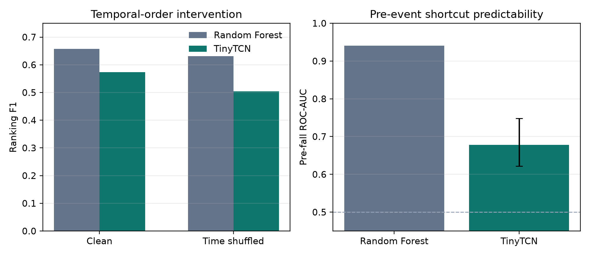

# Temporal-model control

The tabular Random Forest summarizes each two-second window and is largely
insensitive to sample order. A 37,393-parameter TCN provides an order-sensitive
control. Its input is residual CIR power pooled into 25 time steps and 16 range
bands; radar responses are sorted at every time-range location to retain exact
sensor-order invariance. The model is trained only on official training streams.

| Model | Clean ranking F1 | Time-shuffled F1 | Relative loss | Pre-fall ROC-AUC |
|---|---:|---:|---:|---:|
| Random Forest | 0.6575 | 0.6308 | 4.1% | 0.9407 |
| TinyTCN | 0.5731 | 0.5039 | 12.1% | 0.6779 |

The shuffled TCN uses the decoder selected on clean validation folds; no control
parameter is retuned. Its pre-fall stream-bootstrap 95% interval is
[0.6217, 0.7483]. The TCN depends more on temporal order and is substantially
less predictive from pre-event context, but it does not improve localization:
its clean score and F1@0.7 (0.0580) trail the Random Forest. This is a useful
trade-off, not evidence that the neural model is superior.

The result also sharpens the earlier motion-shuffle interpretation. The RF
control was weak by construction because most RF features discard sample order.
The order-sensitive TCN shows a larger degradation, although substantial score
remains after shuffling, so non-temporal evidence is still present.

